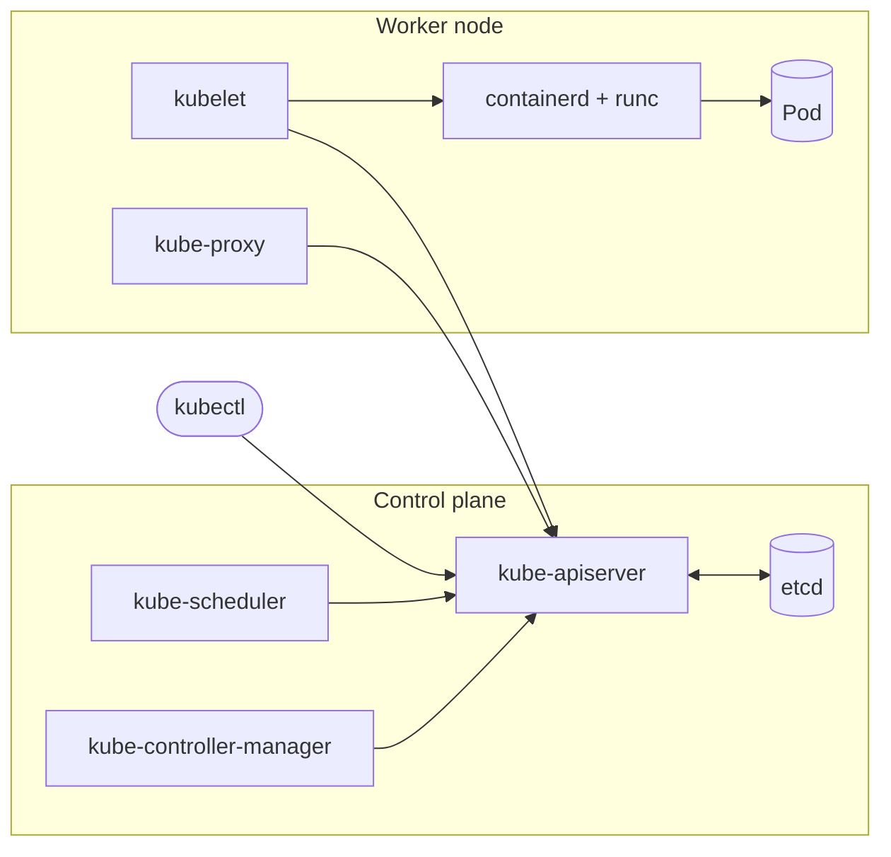

# 01 — Kubernetes Fundamentals: Containers, Architecture & First Pods

> **Course:** Descomplicando o Kubernetes — Expert Mode (LinuxTips), Day 1
> **Level:** Beginner · **Lab time:** ~45 min · **Tools:** Docker, kind, kubectl

## Table of Contents

- [Overview & Learning Objectives](#overview--learning-objectives)
- [Folder Structure](#folder-structure)
- [Key Concepts](#key-concepts)
- [Hands-on Lab](#hands-on-lab)
- [Troubleshooting](#troubleshooting)
- [Interview & Real-World Context](#interview--real-world-context)
- [References](#references)

---

## Overview & Learning Objectives

Before running anything on Kubernetes you need a clear mental model of **what actually runs a container** and **which component is responsible for what** in a cluster. In production, almost every incident — a Pod stuck in `Pending`, a node going `NotReady`, an image that will not pull — is diagnosed by knowing which layer owns the problem.

By the end of this module you will be able to:

- Explain the difference between a **container engine**, a **container runtime**, the **OCI** specs and the **CRI**.
- Describe the **control plane** and **worker node** components and how a Pod gets scheduled.
- Create a **multi-node local cluster** with kind from a declarative config file.
- Create Pods **imperatively** (`kubectl run`) and **declaratively** (`kubectl apply -f`), and generate YAML with `--dry-run=client`.
- Write a clean Pod manifest with **recommended labels**, a **pinned image** and **resource requests/limits**.
- Expose a Pod outside a kind cluster with a **NodePort** Service and `extraPortMappings`.

## Folder Structure

```
01-kubernetes-fundamentals/
├── README.md                        # this guide
├── commands.md                      # kubectl / kind cheat sheet for the module
├── kind/
│   ├── kind-basic.yaml              # 1 control plane + 2 workers
│   └── kind-multinode.yaml          # 1 control plane + 3 workers + host port 8080 -> NodePort 30080
├── manifests/
│   ├── pod-nginx.yaml               # nginx Pod "giropops"
│   └── service-nginx-nodeport.yaml  # NodePort Service exposing the Pod
└── challenge/
    ├── README.md                    # "Pessoa Diretora X" challenge + solution
    ├── kind-cluster-diretora-x.yaml
    └── pod-diretora-x.yaml
```

---

## Key Concepts

### Container engine vs. container runtime

| Layer | Responsibility | Examples |
|-------|----------------|----------|
| **Container engine** | User/API-facing tool: pulls and manages images, volumes, networks; asks a runtime to start containers | Docker, Podman, CRI-O, containerd |
| **High-level runtime** | Manages container lifecycle and images on a node; what the kubelet talks to through the CRI | containerd, CRI-O |
| **Low-level runtime** | Talks to the kernel (namespaces, cgroups) to actually create the process | runc, crun |
| **Sandboxed runtime** | Adds an isolation layer (user-space kernel or micro-VM) for untrusted workloads | gVisor (`runsc`), Kata Containers |

- **OCI (Open Container Initiative):** a Linux Foundation project that standardises the *image format* and the *runtime spec*. Any OCI image runs on any OCI runtime — this is why an image built with Docker runs on a cluster that uses containerd. `runc` is the OCI reference runtime.
- **CRI (Container Runtime Interface):** the gRPC API the **kubelet** uses to talk to a runtime. Since Kubernetes 1.24 the built-in Docker shim (*dockershim*) is gone; nodes use a CRI runtime such as containerd or CRI-O. Images built with Docker still work, because they are OCI images.

### Kubernetes architecture



| Component | Runs on | Role |
|-----------|---------|------|
| `kube-apiserver` | Control plane | Single entry point of the cluster; validates and persists every object. All other components talk to it — never to each other directly. |
| `etcd` | Control plane | Consistent key-value store holding the whole cluster state. Back it up. |
| `kube-scheduler` | Control plane | Picks a node for every unscheduled Pod based on resources, taints/tolerations, affinity. |
| `kube-controller-manager` | Control plane | Runs reconciliation loops (Deployment, ReplicaSet, Node, Job controllers…) that drive *actual* state toward *desired* state. |
| `kubelet` | Every node | Agent that receives Pods assigned to its node and runs them through the CRI; reports node and Pod status. |
| `kube-proxy` | Every node | Programs iptables/IPVS rules so Service IPs and NodePorts route to Pod IPs. |
| CoreDNS | As Pods | Cluster DNS (`<service>.<namespace>.svc.cluster.local`). |

**What happens on `kubectl apply -f pod.yaml`:** kubectl sends the object to the API server → it is validated and stored in etcd → the scheduler sees a Pod with no `nodeName` and binds it to a node → that node's kubelet sees the Pod, asks the runtime to pull the image and start the container → kubelet reports status back to the API server.

### kind (Kubernetes IN Docker)

kind runs each Kubernetes **node as a Docker container**, so you get a real multi-node cluster on a laptop in about a minute. It is ideal for learning, CI pipelines and testing manifests. Alternatives: **minikube** (single-node by default, many add-ons), **k3d** (k3s in Docker), and **kubeadm** on VMs for something closer to bare-metal production.

### Pods

A **Pod** is the smallest deployable unit: one or more containers that share a network namespace (same IP, `localhost` between them) and can share volumes. Pods are **ephemeral** — if one dies, nothing recreates it unless a controller (ReplicaSet/Deployment, covered in later modules) owns it. Bare Pods are for learning and debugging; production workloads use Deployments, StatefulSets, DaemonSets or Jobs.

### Imperative vs. declarative

| | Imperative | Declarative |
|---|---|---|
| Example | `kubectl run giropops --image nginx:1.30` | `kubectl apply -f pod.yaml` |
| Good for | Quick tests, the CKA/CKAD exam | Everything that must be repeatable |
| Versioned in Git | No | Yes — the basis of GitOps |

Bridge between both: `kubectl run ... --dry-run=client -o yaml > pod.yaml` generates the YAML without creating anything.

### What was improved in the manifests

| Practice | Why it matters |
|----------|----------------|
| Pinned image tag (`nginx:1.30`, not implicit `latest`) | Reproducible deploys; you know exactly what runs and rollbacks are meaningful. |
| `app.kubernetes.io/*` labels | Standard labels understood by tools (Helm, dashboards, monitoring) and used by Service selectors. |
| `resources.requests` / `limits` | Requests let the scheduler place Pods correctly; limits stop one Pod from starving the node. Without them the Pod is `BestEffort` QoS and the first to be evicted. |
| Named container port (`http`) | Services can target the name, so changing the port number touches one place. |
| Removed `creationTimestamp: null`, `status: {}`, `resources: {}` | Generated noise from `--dry-run`; keeps manifests readable and diffs clean. |
| kind port mapping fixed from `udp` to `TCP` | HTTP runs over TCP; the original mapping could never serve nginx. |

---

## Hands-on Lab

### Prerequisites

| Tool | Check |
|------|-------|
| Docker (running) | `docker info` |
| kind | `kind version` — [install guide](https://kind.sigs.k8s.io/docs/user/quick-start/#installation) |
| kubectl | `kubectl version --client` — [install guide](https://kubernetes.io/docs/tasks/tools/) |

All commands below run from this folder (`01-kubernetes-fundamentals/`).

### 1. Create the cluster

```bash
kind create cluster --config kind/kind-multinode.yaml
kubectl cluster-info --context kind-dk8s
kubectl get nodes -o wide
```

Expected: 4 nodes (`dk8s-control-plane`, `dk8s-worker`, `dk8s-worker2`, `dk8s-worker3`), all `Ready`. Each node is a Docker container — confirm with `docker ps`.

### 2. Explore the control plane

```bash
kubectl get pods -n kube-system -o wide
```

You should see `etcd`, `kube-apiserver`, `kube-controller-manager` and `kube-scheduler` on the control-plane node, plus `kube-proxy` and the CNI (`kindnet`) on **every** node, and CoreDNS.

### 3. Create a Pod imperatively, then generate YAML

```bash
kubectl run test-nginx --image nginx:1.30 --port 80
kubectl get pods -o wide
kubectl run test-nginx --image nginx:1.30 --port 80 --dry-run=client -o yaml   # prints YAML only
kubectl delete pod test-nginx
```

### 4. Deploy the Pod declaratively

```bash
kubectl apply -f manifests/pod-nginx.yaml
kubectl wait --for=condition=Ready pod/giropops --timeout=90s
kubectl get pod giropops -o wide --show-labels
kubectl describe pod giropops     # read the Events section: Scheduled -> Pulling -> Pulled -> Created -> Started
```

Look at the QoS class assigned because of the requests/limits:

```bash
kubectl get pod giropops -o jsonpath='{.status.qosClass}{"\n"}'   # Burstable
```

### 5. Access nginx

**Option A — port-forward (works on any cluster):**

```bash
kubectl port-forward pod/giropops 8081:80
# in another terminal
curl -I http://localhost:8081
```

**Option B — NodePort Service through the kind port mapping:**

```bash
kubectl apply -f manifests/service-nginx-nodeport.yaml
kubectl get svc giropops
curl -I http://localhost:8080
```

Both should return `HTTP/1.1 200 OK` with `Server: nginx`.

### 6. Get inside the container

```bash
kubectl exec -ti giropops -- bash
# inside the container:
cat /etc/os-release
nginx -v
exit
kubectl logs giropops     # the access log shows your curl requests
```

### 7. Clean up

```bash
kubectl delete -f manifests/
kind delete cluster --name dk8s
```

### Challenge

Solve the [**"Pessoa Diretora X" challenge**](challenge/README.md): build a 1 + 3 node cluster and run an nginx Pod from a definition file.

---

## Troubleshooting

| Symptom | Likely cause | How to investigate / fix |
|---------|--------------|--------------------------|
| `kind create cluster` fails with `Cannot connect to the Docker daemon` | Docker is not running or your user is not in the `docker` group | `sudo systemctl start docker`; `sudo usermod -aG docker $USER` and log in again |
| `failed to create cluster: ... port is already allocated` | Host port 8080 is used by another process | `ss -ltnp \| grep 8080`; change `hostPort` in `kind/kind-multinode.yaml` |
| Nodes stay `NotReady` | CNI not up yet, or the host is short on resources | Wait ~1 min; `kubectl describe node <name>`; check `kubectl get pods -n kube-system` |
| Pod in `ErrImagePull` / `ImagePullBackOff` | Wrong image name/tag, no internet, registry rate limit | `kubectl describe pod <pod>` → Events show the exact pull error |
| Pod stuck in `Pending` | No node can satisfy the requests, or taints block scheduling | `kubectl describe pod <pod>` → `FailedScheduling` message explains why |
| Pod in `CrashLoopBackOff` | The container process keeps exiting | `kubectl logs <pod> --previous` |
| Pod `OOMKilled` | Container used more memory than its limit | `kubectl describe pod <pod>` → `Last State: Terminated, Reason: OOMKilled`; raise the limit or fix the leak |
| `curl localhost:8080` refuses connection | Service missing, wrong selector, or the cluster was created without the port mapping | `kubectl get endpoints giropops` must list the Pod IP; recreate the cluster from `kind-multinode.yaml` if needed |
| `kubectl exec ... -- bash` fails with `executable file not found` | Image has no bash (e.g. Alpine, distroless) | Use `-- sh`, or `kubectl debug` with an ephemeral container |
| `error: unknown flag: --name` on `kubectl run` | The Pod name is positional | `kubectl run <name> --image ...` |

---

## Interview & Real-World Context

<details>
<summary><strong>1. What is the difference between Docker, containerd and runc?</strong></summary>

Docker is a full container engine (CLI, image builds, networking) that internally uses **containerd** to manage containers, which in turn uses **runc** to create them via kernel namespaces and cgroups. Kubernetes nodes only need a CRI runtime, typically containerd or CRI-O, plus runc.
</details>

<details>
<summary><strong>2. Kubernetes removed dockershim. Do Docker-built images still work?</strong></summary>

Yes. Docker produces **OCI-compliant images**, and any CRI runtime (containerd, CRI-O) can run them. What changed is only how the kubelet talks to the runtime on the node.
</details>

<details>
<summary><strong>3. Walk me through what happens when you run <code>kubectl apply -f pod.yaml</code>.</strong></summary>

kubectl → API server (authentication, authorization, admission, validation) → object persisted in etcd → scheduler binds the Pod to a node → kubelet on that node pulls the image and starts the containers through the CRI → kubelet reports status → API server updates etcd. Every component communicates through the API server.
</details>

<details>
<summary><strong>4. What happens to running Pods if the control plane goes down?</strong></summary>

Existing containers keep running — the kubelet and runtime are on the nodes. But nothing new can be scheduled, failed Pods are not replaced, and `kubectl` does not work. That is why production clusters run an HA control plane (3+ API servers and an odd-sized etcd cluster) and back up etcd.
</details>

<details>
<summary><strong>5. Why should you not run bare Pods in production?</strong></summary>

A bare Pod is not recreated if it is deleted, evicted or its node fails. Controllers such as Deployments maintain the desired number of replicas, handle rolling updates and allow rollbacks.
</details>

<details>
<summary><strong>6. What is the difference between resource requests and limits?</strong></summary>

**Requests** are reserved capacity used by the scheduler to choose a node. **Limits** are enforced at runtime: exceeding the CPU limit causes throttling; exceeding the memory limit gets the container OOM-killed. Together they define the QoS class (`Guaranteed`, `Burstable`, `BestEffort`) that decides eviction order under node pressure.
</details>

<details>
<summary><strong>7. Why avoid the <code>latest</code> tag?</strong></summary>

It is mutable: two nodes can run different images under the same tag, deploys are not reproducible and rollbacks are meaningless. Pin a version — or an image digest for the strongest guarantee.
</details>

<details>
<summary><strong>8. Scenario: a Pod has been <code>Pending</code> for 10 minutes. How do you debug it?</strong></summary>

`kubectl describe pod <name>` and read the `FailedScheduling` event. Usual causes: insufficient CPU/memory on every node (check `kubectl describe node` → *Allocated resources*), taints without matching tolerations, an unsatisfiable `nodeSelector`/affinity, or an unbound PersistentVolumeClaim.
</details>

<details>
<summary><strong>9. When would you use kind, minikube or a managed cluster (EKS/GKE/AKS)?</strong></summary>

kind: fast, disposable multi-node clusters for learning and CI. minikube: a local single-node cluster with many add-ons. Managed services: production, where the provider runs and upgrades the control plane and you focus on workloads.
</details>

---

## References

- [Kubernetes components](https://kubernetes.io/docs/concepts/overview/components/)
- [Pods](https://kubernetes.io/docs/concepts/workloads/pods/)
- [Recommended labels](https://kubernetes.io/docs/concepts/overview/working-with-objects/common-labels/)
- [Resource management for Pods and containers](https://kubernetes.io/docs/concepts/configuration/manage-resources-containers/)
- [Container runtimes](https://kubernetes.io/docs/setup/production-environment/container-runtimes/)
- [kind documentation](https://kind.sigs.k8s.io/) · [kind configuration](https://kind.sigs.k8s.io/docs/user/configuration/)
- [kubectl quick reference](https://kubernetes.io/docs/reference/kubectl/quick-reference/)
- [Open Container Initiative](https://opencontainers.org/)
- [Descomplicando o Kubernetes (LinuxTips)](https://github.com/badtuxx/DescomplicandoKubernetes)

---

⬅️ [Back to the learning path](../README.md) · ➡️ Next: *02 — (pending restructure of `day-2`)*
